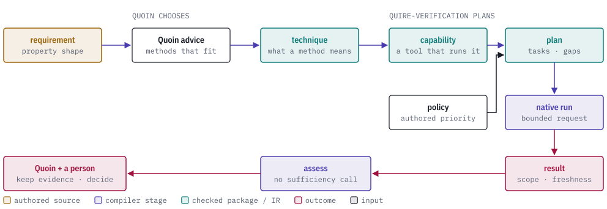
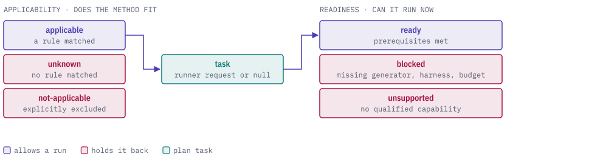

# quire-verification

quire-verification is a Rust crate that turns a requirement into an explicit
verification plan: which techniques apply, which tool capability could run each
one, and what is still missing.

It defines portable, versioned contracts for tool qualification, blocked tasks
and stale results, and plans against them. Quoin supplies the verification
methods that fit a requirement and keeps the evidence, and a person decides
whether the evidence is enough. The crate does not run tools.

<picture>
  <source media="(prefers-color-scheme: dark)" srcset="docs/images/hero-dark.svg">
  
</picture>

> **Status: prerelease, private repository.** The planning interfaces and
> evidence assessment are accepted for exact private Rust consumers only. No
> schema is published. Each native verification tool is gated separately, and a
> validating fixture does not claim that a tool ran.

## The five contracts

All five are defined in [`contracts/e02-draft-2.schema.json`](contracts/e02-draft-2.schema.json)
and validated through the public `quire-verification-contracts` crate.

| Contract | What it says |
|---|---|
| `TechniqueDefinition` | What a verification method means and where it may apply. Keeps Quoin's method id byte for byte. Makes no claim that a tool is installed. |
| `ToolCapability` | Binds one technique to a native producer and adapter, with input kinds, prerequisites, resource limits, qualification state and claim limits. |
| `SelectionPolicy` | Explainable rules with source provenance and an authored priority (`required`, `recommended`, `optional`) and no computed score. An expired policy adds a freshness prerequisite. |
| `VerificationPlan` | An inventory of properties, then tasks. Each task has one of five input shapes: `state`, `relational`, `trace`, `fault` or `manual`. |
| `TechniqueResult` | One run's outcome with execution status, logical outcome, activation, assumptions, observation adequacy, exact scope and provenance kept as separate fields. |

## How a plan is built

Applicability and readiness are separate answers, so a method that fits but
cannot run yet stays visible in the plan.

<picture>
  <source media="(prefers-color-scheme: dark)" srcset="docs/images/task-states-dark.svg">
  
</picture>

- Quoin's `inconclusive` advice becomes `unknown`.
- Missing generators, harnesses, tools, permissions, observations or reviewer
  assignments are listed as prerequisites to satisfy.
- Fault tasks stay blocked without an explicit non-production authorization
  and an injection binding.
- A native runner request is closed and finite: the selected capability,
  adapter, permissions, input and one budget. Manual work never receives
  invocation permission.

Evidence assessment then compares each result with the plan: exact
plan/task/run/producer/adapter binding, scope, freshness, and every
simultaneous finding. Ambiguous duplicate results are reported and not merged.

## Usage

The smallest real use is the fixture plan in
[`tests/verification.rs`](tests/verification.rs), which validates the shared
references a request carries and builds the plan:

```rust
let references = validated_fixture_references(request)?;
build_plan_from_validated(request, &references)
```

where `request` is the `planRequest` in
[`fixtures/portfolio.json`](fixtures/portfolio.json) and
`build_plan_from_validated` is `quire_verification::planner::build_verification_plan`.
The same test file adapts Quoin's exports with
`adapt_quoin_catalog(&fixture("quoin-catalog-export.json"))` and assesses
results with `assess_evidence(&packet, &references)`.

From the command line:

```sh
cargo run --locked --bin validate-fixtures      # every fixture against the schema
cargo run --locked --bin render-fixtures        # the retained evidence packet
cargo run --locked --bin run-bounded-portfolio -- "$(git rev-parse HEAD)" 2026-09-08T02:00:00Z
```

`run-bounded-portfolio` checks catalog field parity keyed by `techniqueId` and
permutation invariance. A violated check or a failed execution is kept as its
own `TechniqueResult`, and an `inspection` result stays `not-run` until a
person records the disposition.

## Values

| Dimension | Values |
|---|---|
| Input shape | `state`, `relational`, `trace`, `fault`, `manual` |
| Applicability | `applicable`, `not-applicable`, `unknown` |
| Readiness | `ready`, `blocked`, `unsupported` |
| Execution status | `not-run`, `running`, `completed`, `failed`, `cancelled`, `exhausted`, `invalid-input`, `unsupported` |
| Logical outcome | `satisfied`, `violated`, `unknown`, `not-evaluated`, `inconclusive` |

Oracle contributions record whether a result's oracle and observation are
independent, shared, derived or unknown. Further reading:
[interface decision](docs/interface-decision.md),
[Quoin compatibility map](docs/quoin-compatibility.md),
[contract packet](contracts/README.md) and the
[historical evaluation report](docs/evaluation-report.md).

## Quire ecosystem

<picture>
  <source media="(prefers-color-scheme: dark)" srcset="docs/images/ecosystem-dark.svg">
  
</picture>

quire-verification sits above the main chain. It depends on
`quire-verification-contracts` (the schema and canonicalization boundary),
`quire-analyze` (method contract) and `engineering-assurance` (native
execution and evidence), all from `Cargo.toml`. Quoin supplies the catalog and
advice across a versioned JSON boundary and keeps its own orchestration.

## Building and testing

```sh
cargo fmt --all -- --check
cargo clippy --workspace --all-targets --all-features --locked -- -D warnings
cargo test --workspace --all-features --locked
cargo fuzz build -D --sanitizer none
cargo deny check
```

Acceptance tests carry a compiler-checked `#[trace(...)]` marker from
`ix-trace-rs`; `quire coverage --scope . --json` reports them against the
specs in [`spec/`](spec/). Implementation is Rust; see [AGENTS.md](AGENTS.md)
for the language policy.

## Contributing and license

Every contribution needs a signed CLA; see [CONTRIBUTING.md](CONTRIBUTING.md)
and [CLA.md](CLA.md). The code is AGPL-3.0-or-later ([LICENSE](LICENSE)). Repository visibility and license
are separate decisions: publication needs a fresh review.
