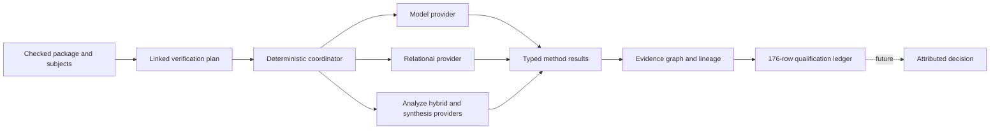

# Complete-V1 method and evidence architecture

## System Boundary

`quire-verification` owns linked plan validation, deterministic coordination,
model-test and relational providers, typed method-result composition, evidence
graph construction, counterexample lineage, and qualification-ledger accounting.
`quire-analyze` owns continuous/hybrid reachability and bounded synthesis.
Checked-package/native-runtime producers, other method providers, Engineering
Assurance execution, Quoin retention/sufficiency, integrated execution, and the
eventual human decision remain external and cross exact versioned interfaces.

This is a development architecture. Provider implementation, local tests, and
cross-repository integration proceed with explicit planned, unexecuted,
unsupported, or failed states; they do not wait for production evidence,
production profiles, release ceremony, or an owner disposition.

## Views

The plan/result boundary adopts QSpec I14/I15. The evidence boundary adopts
I18-I21. Semantic outcomes and provider execution states are separate axes.
Every node reaches one terminal disposition, so a failed prerequisite blocks
only typed descendants while siblings remain available.

## Decisions

1. Use external linked plans rather than embedding verification tools in clause syntax.
2. Keep method providers independent behind one versioned request/result contract.
3. Derive model-test data from checked source domains and use native replay, not implementation types, as the semantic oracle.
4. Represent trace populations, ordered quantifiers, alignment, correlation, and declassification explicitly.
5. Keep candidate discovery distinct from independent candidate checking.
6. Emit typed evidence and ledger records while leaving retention and sufficiency with Quoin.
7. Treat absent production evidence as later qualification state, never as a development dependency.

## Risks

- **Shared-contract drift — owner: lane D; review before each consumer merge.** Pin merged QSpec and producer revisions; report contradictions upstream.
- **Outcome promotion — owner: method implementer; review in every provider PR.** Enforce disjoint semantic and execution dispositions in the common result type.
- **Correlated evidence — owner: evidence implementer; review before ledger intake.** Retain dependence and reject circular/self discharge.
- **Ceremony coupling — owner: lane D; review in plan changes.** No development task may depend on a production profile, production evidence, or final decision.

