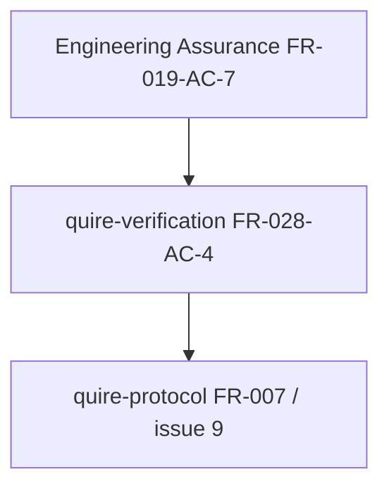

# Dependency Review — E02 Dependency-Compatible Consumer Requirement

## Summary

The dependency review separates the upstream library-policy repair from the
qverify pin and the downstream Protocol projection. The graph is acyclic: the
merged Engineering Assurance compatibility boundary enables qverify's exact
pin, which enables Protocol to select the resulting exact qverify revision.

## Findings

| ID | Severity | Summary | Refs |
| --- | --- | --- | --- |
| FND-001 | low | No dependency cycle or missing prerequisite remains in the issue-44 amendment; implementation must retain the stated order. | FR-028-AC-4; engineering-assurance#102; quire-verification#44; quire-protocol#9 |

## Classification

| Requirement | Class | Rationale |
| --- | --- | --- |
| Engineering Assurance FR-019-AC-7 | Enablement | Publishes consumer-compatible normal dependency requirements while retaining EA's exact lock. |
| FR-028-AC-4 | Enablement | Selects and proves one exact dependency-compatible qverify consumer revision without changing E02 semantics. |
| Protocol FR-007 | Feature | Consumes the exact qverify E02 boundary to project Protocol results. |

## Dependency Graph

## Topological Order

1. Engineering Assurance PR 106 / merge `9237ce50ce19c6d6c937705bfde4b64adcc9d16b`.
2. qverify issue 44 exact revision selection and consumer compilation.
3. Protocol issue 9 exact qverify pin and projection gate.

## Cycles

None detected.
