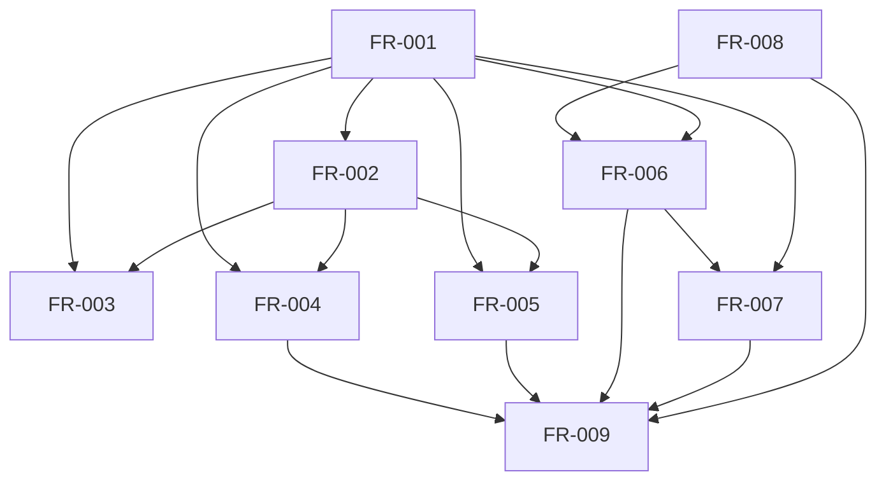

# Dependency review of the Rust bounded compatibility specification

## Summary

The normative dependency graph is acyclic. Contract generation and validation
enable fixture handling, adaptation, planning, and assessment; JCS enables exact
matching; the composed portfolio follows those library capabilities.

## Findings

| ID | Severity | Summary | Refs |
|----|----------|---------|------|
| FND-001 | low | No dependency cycle or missing hard prerequisite remains in the requirement graph. | FR-001..FR-009 |

## Classification

| Requirement | Class | Rationale |
|-------------|-------|-----------|
| FR-001 | Enablement | Establishes public wire validation. |
| FR-002 | Enablement | Generates runtime behavior from the schema. |
| FR-003 | Feature | Executes contract validation over every fixture. |
| FR-004 | Feature | Adapts the external Quoin catalog boundary. |
| FR-005 | Feature | Builds verification plans. |
| FR-006 | Feature | Matches result evidence exactly. |
| FR-007 | Feature | Classifies and preserves independent findings. |
| FR-008 | Enablement | Supplies canonical digest and equality behavior. |
| FR-009 | Feature | Composes the bounded local portfolio. |
| NFR-001 | Cross-cutting | Constrains deterministic output. |
| NFR-002 | Cross-cutting | Constrains contract-source ownership. |
| NFR-003 | Cross-cutting | Constrains assurance claims. |
| NFR-004 | Cross-cutting | Constrains executable language and gates. |
| NFR-005 | Cross-cutting | Constrains resource use at JSON boundaries. |

`ix-trace-rs` is a test-only compile-time dependency of NFR-004. It does not
enter the runtime contract or Quoin boundary. Engineering Assurance consumes
portable outputs through its separately owned Rust implementation.

## Dependency Graph

## Topological Order

1. FR-001 and FR-008.
2. FR-002 and FR-006.
3. FR-003, FR-004, FR-005, and FR-007.
4. FR-009.

## Cycles

None detected.
