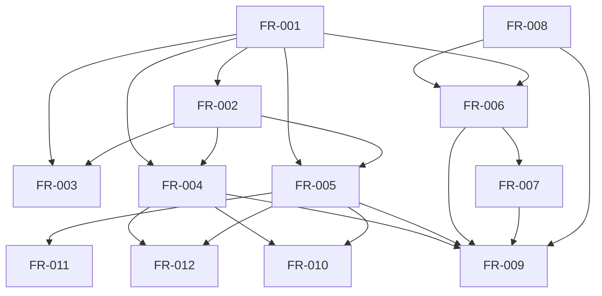

# Dependency review of the VP01 qualification specification

## Summary

The requirement graph is acyclic. Contract validation and catalog/planner
behavior precede the three VP01 qualification requirements; E02 remains an
external acceptance prerequisite rather than an undeclared implementation edge.

## Findings

| ID | Severity | Summary | Refs |
|----|----------|---------|------|
| FND-001 | low | No dependency cycle or missing internal prerequisite remains after adding the FR-004/FR-005 edges for FR-010 through FR-012. | FR-010, FR-011, FR-012 |
| FND-002 | low | E02 is still open, so implementation evidence may advance but VP01 acceptance and closure must remain pending. | spec/spec.md, FR-010..FR-012 |

## Classification

| Requirement | Class | Rationale |
|-------------|-------|-----------|
| StR-001 | Feature | States the stakeholder-visible Rust and evidence-integrity outcome. |
| FR-001 | Enablement | Establishes public wire validation. |
| FR-002 | Enablement | Generates runtime behavior from the schema. |
| FR-003 | Feature | Executes contract validation over every fixture. |
| FR-004 | Feature | Adapts the external Quoin catalog boundary. |
| FR-005 | Feature | Builds verification plans. |
| FR-006 | Feature | Matches result evidence exactly. |
| FR-007 | Feature | Classifies and preserves independent findings. |
| FR-008 | Enablement | Supplies canonical digest and equality behavior. |
| FR-009 | Feature | Composes the bounded local portfolio. |
| FR-010 | Feature | Keeps applicability and readiness independent. |
| FR-011 | Feature | Emits authored or explicit unknown classification. |
| FR-012 | Feature | Preserves authored priority and reasons. |
| NFR-001 | Cross-cutting | Constrains deterministic output. |
| NFR-002 | Cross-cutting | Constrains contract-source ownership. |
| NFR-003 | Cross-cutting | Constrains assurance claims. |
| NFR-004 | Cross-cutting | Constrains executable language and quality gates. |
| NFR-005 | Cross-cutting | Constrains resource use at JSON boundaries. |

## Dependency Graph

## Topological Order

1. FR-001 and FR-008.
2. FR-002 and FR-006.
3. FR-003, FR-004, FR-005, and FR-007.
4. FR-009, FR-010, FR-011, and FR-012.

## Cycles

None detected.
