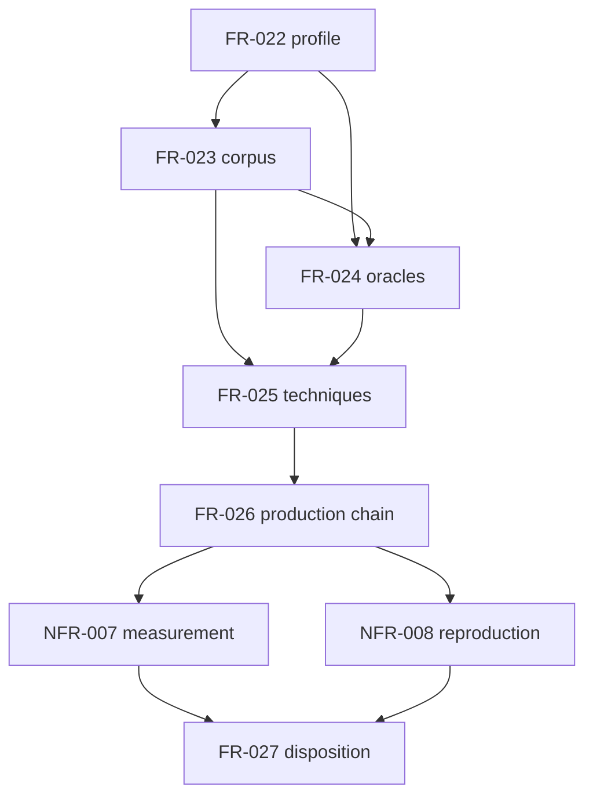

# Dependency review of the issue 13 qualification specification

## Summary

The internal requirement graph is acyclic. Profile and contract readiness precede
corpus and oracle work; evidence precedes the real chain; measurement and reproduction
precede the final disposition. External E02, FS02, FS05, compiler, caller, and assurance
revisions are gates owned outside this plan.

## Classification

| Requirement | Class | Rationale |
|-------------|-------|-----------|
| StR-002 | Feature | Defines the owner-visible qualification decision. |
| FR-022 | Enablement | Freezes the identity and claim every later artifact uses. |
| FR-023 | Enablement | Supplies the closed input population and lineage. |
| FR-024 | Enablement | Defines the oracle authority and dependence model. |
| FR-025 | Feature | Produces one exact result for each selected discriminating evidence technique. |
| FR-026 | Feature | Exercises the selected real production chain. |
| NFR-007 | Cross-cutting constraint | Governs measurement for the production chain. |
| NFR-008 | Cross-cutting constraint | Governs all retained identities and reproduction. |
| FR-027 | Feature | Seals evidence and binds the external disposition. |

## Dependency graph

## Topological order

1. Freeze FR-022 and accept the exact external interface set.
2. Build FR-023, then FR-024.
3. Execute FR-025 and FR-026.
4. Discharge NFR-007 and NFR-008 before FR-027.

## Findings

| ID | Severity | Summary | Refs |
|----|----------|---------|------|
| FND-001 | medium | Resolved: Task-029 and Task-032 now own completion of the shared TC-042 and TC-044 gates after their explicit enabling tasks. | Task-028..Task-032, TC-042, TC-044 |
| FND-002 | low | No cycle or implicit internal prerequisite remains; unavailable external revisions block only their dependent tasks. | FR-022, FR-026, AD-002 |
