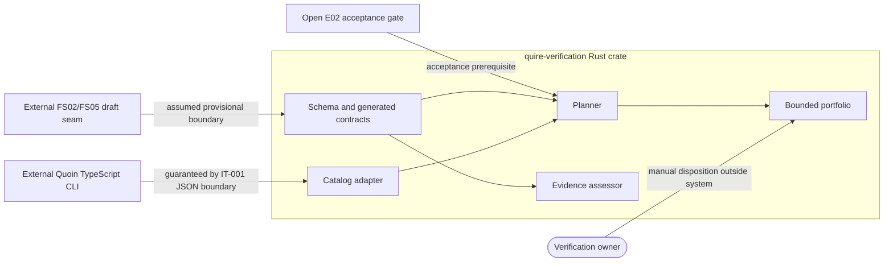

# Scope and boundary review of the VP01 qualification specification

## Summary

The Rust crate owns contract validation, catalog adaptation, planning, result
assessment, and bounded local execution. Quoin owns catalog production and
evidence retention, humans own sufficiency and acceptance, E02 gates VP01, and
the draft FS02/FS05 seam remains outside this increment.

## Findings

| ID | Severity | Summary | Refs |
|----|----------|---------|------|
| FND-001 | low | No responsibility collision or unclassified runtime dependency exists in the VP01 increment. | spec/spec.md, FR-010..FR-012, IT-001 |
| FND-002 | low | Proposed `ix.artifact-ref/2-draft` adoption belongs to the later shared identity/result integration scope; this VP01 change neither accepts nor implements it. | spec/spec.md, FR-006 |

## System Context

## External Dependencies

| Dependency | Type | Assumed or Guaranteed | Contract |
|------------|------|------------------------|----------|
| Quoin method catalog | JSON producer | Guaranteed | IT-001 |
| E02 acceptance | Program gate | Assumed and open | quire-research E02 |
| FS02/FS05 identity model | Cross-repository decision | Assumed provisional | Out-of-scope boundary in spec/spec.md |
| Human verification owner | Decision authority | Assumed external | NFR-003 claim limit |

## Responsibility Allocation

| Requirement | Owning Component | Class |
|-------------|------------------|-------|
| StR-001 | repository-wide | core |
| FR-001 | contracts | core |
| FR-002 | contracts/build | infrastructure |
| FR-003 | fixture validator | infrastructure |
| FR-004 | catalog adapter | core |
| FR-005 | planner | core |
| FR-006 | evidence assessor | core |
| FR-007 | evidence assessor | core |
| FR-008 | canonicalization | cross-cutting |
| FR-009 | bounded portfolio | core |
| FR-010 | planner | core |
| FR-011 | contracts and planner | core |
| FR-012 | contracts and planner | core |
| NFR-001 | repository-wide | cross-cutting |
| NFR-002 | contracts/build | cross-cutting |
| NFR-003 | repository-wide | cross-cutting |
| NFR-004 | workspace and CI | cross-cutting |
| NFR-005 | ingestion and validation | cross-cutting |
