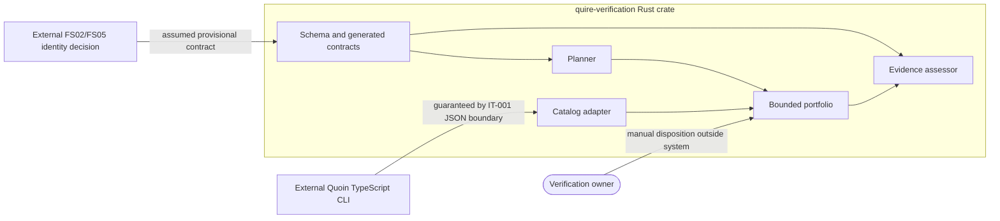

# Scope and boundary review of the Rust bounded compatibility specification

## Summary

The Rust crate owns contract validation, adaptation, planning, assessment, and
bounded local execution. Quoin owns catalog production and evidence storage;
humans own sufficiency and acceptance. The real Quoin boundary is guaranteed by
IT-001, while FS02/FS05 acceptance remains assumed and out of scope.

## Findings

| ID | Severity | Summary | Refs |
|----|----------|---------|------|
| FND-001 | low | No unresolved responsibility collision or unclassified external dependency was found. | spec/spec.md, IT-001 |

## System Context

## External Dependencies

| Dependency | Type | Assumed or Guaranteed | Contract |
|------------|------|------------------------|----------|
| Quoin method catalog | JSON producer | Guaranteed | IT-001 |
| FS02/FS05 identity model | Cross-repository decision | Assumed provisional | Out-of-scope boundary in spec/spec.md |
| Human verification owner | Decision authority | Assumed external | NFR-003 claim limit |

## Responsibility Allocation

| Requirement | Owning Component | Class |
|-------------|------------------|-------|
| FR-001 | contracts | core |
| FR-002 | contracts/build | infrastructure |
| FR-003 | fixture-validator binary | infrastructure |
| FR-004 | catalog-adapter | core |
| FR-005 | planner | core |
| FR-006 | evidence assessor | core |
| FR-007 | evidence assessor | core |
| FR-008 | canonicalization | cross-cutting |
| FR-009 | bounded portfolio | core |
| NFR-001 | crate-wide | cross-cutting |
| NFR-002 | contracts/build | cross-cutting |
| NFR-003 | crate-wide | cross-cutting |
| NFR-004 | workspace and CI | cross-cutting |
| NFR-005 | ingestion and validation | cross-cutting |

