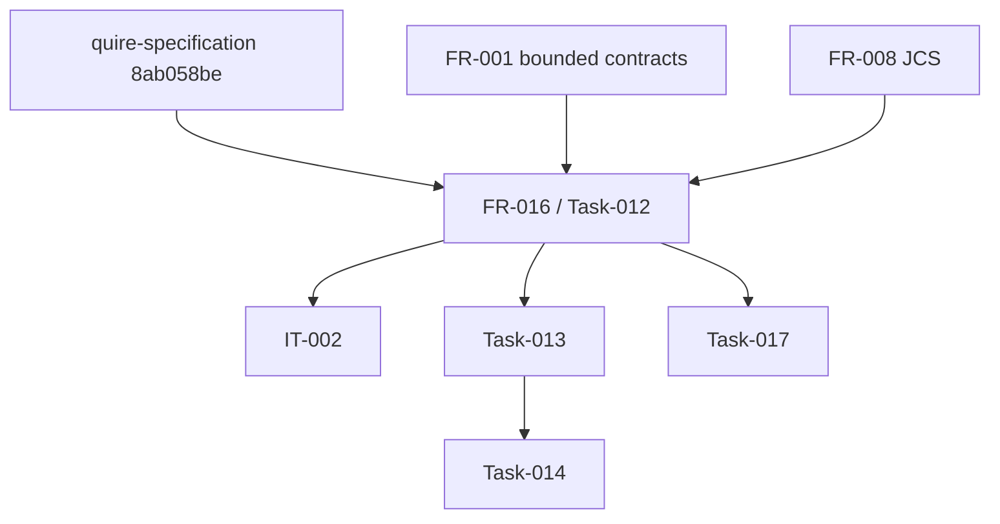

# Dependency Review of Shared-Reference Packet Adoption

## Summary

Merged specification revision `8ab058be` resolves the external representation
dependency. FR-001 and FR-008 are already implemented, so FR-016 and IT-002 are
the next enablement work; the remaining VP02, VP03, and VP04 tasks stay behind
the one strict reader.

## Findings

| ID | Severity | Summary | Refs | Escape Cause |
|----|----------|---------|------|--------------|
| FND-001 | low | The former PR #8 blocker is closed by exact main revision `8ab058beff03cc76c0f39cc06c87ef98f76e8d78`; no compiler, IR #54, Agent C implementation, or human disposition is required for Task-012. | FR-016-CON-1, IT-002 | correct-requirement-no-evidence |
| FND-002 | low | The acyclic order is FR-001/FR-008 plus the accepted packet, then Task-012/IT-002, then Tasks 013–015 and Task-017, followed by their existing downstream chains. | FR-016, Plan-003 | correct-requirement-no-evidence |
| FND-003 | medium | Public reusable-artifact terms remain unresolved, but private qualification use is accepted and the data-only snapshot is explicitly barred from public promotion; this is a release gate rather than an implementation fallback. | FR-016-CON-2, IT-002 | correct-requirement-no-evidence |

## Dependency Graph

