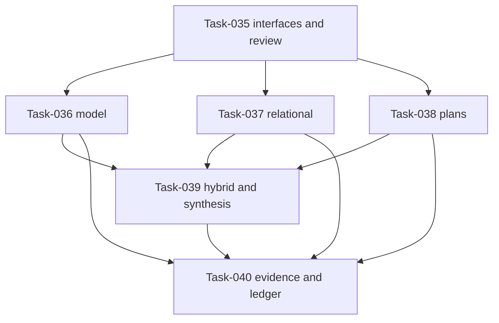

## Summary

The implementation graph is acyclic and separates shared-interface enablement,
independent method features, cross-repository provider integration, and final
evidence accounting. No production ceremony occurs on the development path.

## Findings

| ID | Severity | Summary | Refs |
|----|----------|---------|------|
| FND-001 | low | No unresolved dependency defect remains; the only mandatory gate before provider code is the one-time issue-34 interface/spec review. | Plan-007, Task-035-Task-040 |

## Classification

| Requirement | Class | Rationale |
|---|---|---|
| interfaces 001-002, NFR-009 | Enablement | Versioned method/evidence boundaries and deterministic accounting constraints. |
| FR-029 | Feature | Model generation and shrinking provider. |
| FR-030 | Feature | Relational/hyperproperty provider. |
| FR-031 | Feature | Linked plan coordinator. |
| Analyze #33 | Feature | Hybrid and synthesis providers in the owning repository. |
| FR-032-FR-034 | Feature | Evidence graph, lineage, and qualification ledger. |

## Dependency Graph

## Topological Order

1. Task-035.
2. Task-036, Task-037, and Task-038.
3. Task-039.
4. Task-040.

## Cycles

None detected. Future production evidence and decisions are ledger states, not prerequisites.

