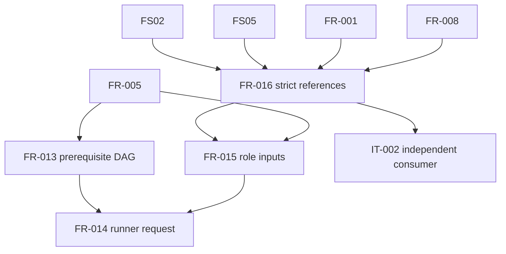

# Dependency Review of the VP02 Native-Planning Specification

## Summary

The internal graph is acyclic. FR-013 is independently implementation-ready;
the exact-reference chain remains blocked on external FS02/FS05 acceptance.

## Findings

| ID | Severity | Summary | Refs |
|----|----------|---------|------|
| FND-001 | high | FS02/FS05 and B's PR #8 amendment findings are unresolved, blocking FR-016, FR-015, FR-014, IT-002, and TC-027 through TC-031. | FR-016, IT-002 |
| FND-002 | low | FR-013 depends only on the already implemented base planner and may proceed after this reviewed specification while downstream shared-reference work remains blocked. | FR-005, FR-013, TC-026 |

## Dependency Graph

## Topological Order

1. Implemented FR-001, FR-005, and FR-008.
2. Dependency-ready FR-013; external FS02/FS05 amendment.
3. FR-016 and IT-002 after the shared amendment.
4. FR-015.
5. FR-014.
