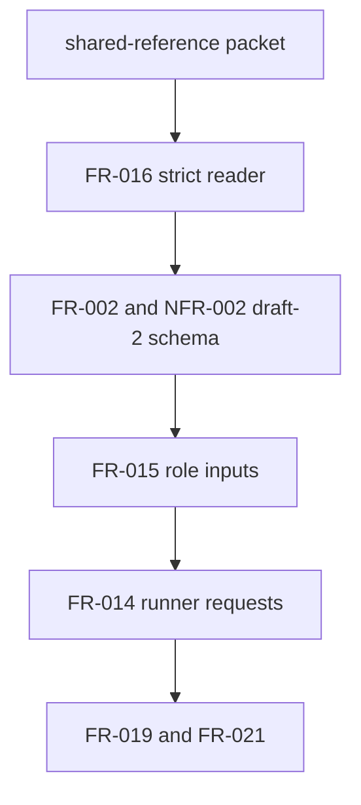

## Summary

The dependency graph is acyclic. The accepted shared-reference packet and
completed strict reader enable the draft-2 schema and role inputs; those inputs
then enable runner requests and downstream evidence and portfolio work.

## Findings

| ID | Severity | Summary | Refs |
|---|---|---|---|
| FND-001 | medium | Resolved at the specification boundary: FR-002 and NFR-002 now own external schema resolution while FR-016 owns reference validation; FR-015 consumes both without redefining either. | FR-002, NFR-002, FR-016, FR-015 |
| FND-002 | medium | Plan maintenance required before implementation: Task-013 must record its added ownership of FR-002-AC-4 and NFR-002-AC-3 alongside FR-015. | Task-013, FR-002-AC-4, NFR-002-AC-3 |
| FND-003 | low | No cycle exists in the selected chain. FR-014 remains blocked until Task-013 closes, and FR-017/FR-019/FR-021 consume the completed VP02 boundary later. | FR-014, FR-017, FR-019, FR-021 |

## Classification and Order

| Requirement | Class | Order |
|---|---|---|
| FR-016 | Enablement: strict reader | Complete before Task-013 |
| FR-002 / NFR-002 | Enablement: one resolved schema source | Implement in Task-013 |
| FR-015 | Feature: closed preserved inputs | Implement after FR-016 with the schema change |
| FR-014 | Feature: runner requests | After FR-015 |
| FR-017 / FR-019 / FR-021 | Feature: evidence and portfolio consumers | After their declared VP02/VP03 prerequisites |

