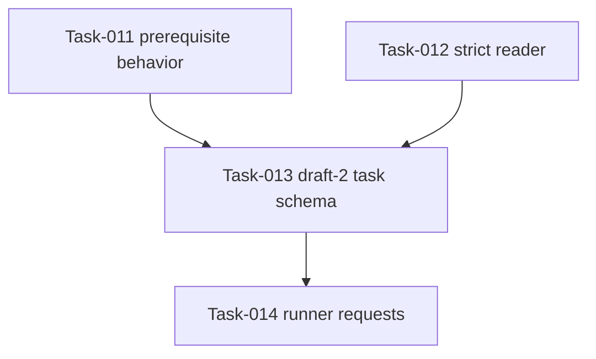

## Summary

The amendment leaves the Plan-003 DAG acyclic and changes no task ordering.
Task-011's setup semantics are refined by Task-013's schema without reopening
its implemented prerequisite behavior.

## Findings

| ID | Severity | Summary | Refs |
|---|---|---|---|
| FND-001 | medium | Resolved: Task-013 must update the public plan schema so completed Task-011 setup records omit property input while retaining prerequisite and `requiredBy`; TC-026 guards the earlier behavior. | Task-011, Task-013, TC-026 |
| FND-002 | low | FR-016 still enables FR-015, and FR-015 still enables FR-014. The setup-input refinement adds no dependency edge or cycle. | FR-016, FR-015, FR-014 |

