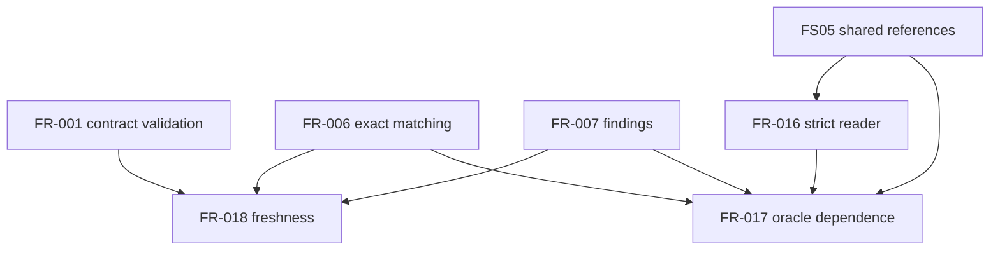

# Dependency Review of the VP03 Evidence-Assessment Specification

## Summary

The internal graph is acyclic. FR-018 is independently implementation-ready;
FR-017 remains blocked on strict FS05 roles through FR-016.

## Findings

| ID | Severity | Summary | Refs |
|----|----------|---------|------|
| FND-001 | high | FS05 lacks the exact oracle and observation roles FR-017 consumes, so FR-017 and TC-033 remain blocked with no fallback. | FR-017, TC-033 |
| FND-002 | low | FR-018 depends only on implemented contract validation, exact matching, and finding preservation and may proceed after this review. | FR-001, FR-006, FR-007, FR-018 |

## Dependency Graph

## Topological Order

1. Implemented FR-001, FR-006, and FR-007.
2. Dependency-ready FR-018.
3. External FS05 role amendment and FR-016.
4. FR-017.
