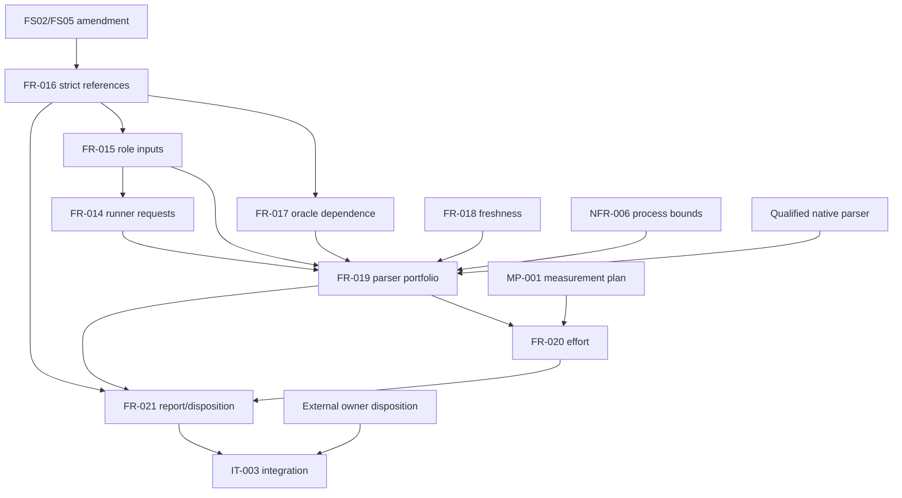

# Dependency Review of the VP04 Native Parser Portfolio Specification

## Summary

The internal VP04 graph is acyclic, but every qualification path reaches the
still-open VP02/VP03 shared-reference chain. No VP04 task is implementation-ready
as a qualified portfolio while that external contract remains conditional.

## Findings

| ID | Severity | Summary | Refs |
|----|----------|---------|------|
| FND-001 | high | FS02/FS05 amendments and Plan-003/Plan-004 completion are hard predecessors of FR-019 and IT-003; FR-020 and FR-021 are downstream and cannot bypass them. | FR-016..FR-021, IT-003 |
| FND-002 | high | FR-021 additionally requires a shared review-disposition role and an actual external verification-owner disposition after the automated core is sealed. | FR-021, TC-037 |
| FND-003 | medium | The exact native parser revision, its own Rust qualification, and fixture redistribution terms must be selected before IT-003 execution; a local worktree is not acceptance evidence. | IT-003-SC-01, IT-003 Preconditions |
| FND-004 | low | The current installed MeasurementPlan schema validates MP-001; Agent C retains the reusable Engineering Assurance provider and migration, while B owns only this domain-specific observation/report behavior. | MP-001, FR-020, quire-research#59 |
| FND-005 | medium | The selected native containment profile adds an explicit Linux facility dependency: `openat2`, `/proc/self/fd`, and process-group signaling must all be available before admission; lack of any facility refuses rather than falling back to pathname execution or direct-child-only cleanup. | NFR-006 Scope, NFR-006-AC-6..7 |

## Dependency Graph

## Topological Order

1. Amend and accept FS02/FS05; complete VP02 and VP03 qualification.
2. Select the exact qualified parser candidate and cleared fixtures.
3. Implement NFR-006 and FR-019 with TC-034, TC-035, and TC-038.
4. Implement FR-020 under MP-001 with TC-036.
5. Implement FR-021 with TC-037, seal the automated core, and obtain the external disposition.
6. Run IT-003 and the VP04 qualification gate.
